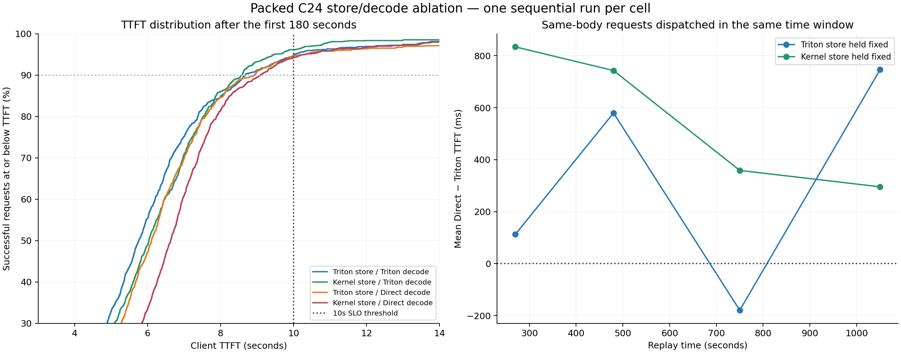

# C24 Packed store/decode ablation — 2026-10-14

Author: Winston Cai.

Direct Packed decode has a consistent mean TTFT penalty in the fixed-store
comparisons, including stricter matched-input cohorts. Kernel store with Triton
decode has almost the same full-run mean TTFT as all-Triton. However, the
post-prefill marker measures the output path after the scheduler has a token
result, and the SLO tail is dominated by queueing. These runs identify a serving
tradeoff; they do not prove that Direct kernel execution causes the gap or rule
out store interaction and session variability.

## Question and protocol

Does the fused selection/normalization/store path explain the Kernel serving TTFT
penalty, or does the penalty follow Direct Packed attention?

Change only the independent store selector. Reuse the earlier all-Triton and
all-Kernel C24 controls; add Kernel store/Triton decode and Triton store/Direct
decode. All runs use the same dataset, adapter and runner hashes, C24 fixed active
users, 1200-second admission window, server seed `20260919`, flushed prefix cache,
TP4, and decode graph coverage through batch 136. These are unprofiled runs.
Native is outside this Packed-only diagnostic.

Acceptance is complete, valid timing collection and verified intended worker
modes, followed by descriptive comparison. No performance promotion gate is
applied. Stop after collecting the two mixed runs and analyzing the four cells;
additional repetitions require a separate run request.

## Client results

| Store | Decode | Successful / failed | Mean TTFT (s) | TTFT p90 (s) | Mean TPOT (ms) | TTFT >10s |
|---|---|---:|---:|---:|---:|---:|
| Triton | Triton | 2200 / 17 | 6.735 | 9.123 | 54.71 | 6.95% |
| Kernel | Triton | 2228 / 14 | 6.740 | 8.702 | 54.18 | 5.48% |
| Triton | Direct Kernel | 2209 / 19 | 6.990 | 9.219 | 52.06 | 7.24% |
| Kernel | Direct Kernel | 2215 / 19 | 7.288 | 9.409 | 51.13 | 7.49% |

All four meet the specified TTFT p90 <10s threshold in this sample. The mixed
Kernel-store/Triton-decode run has 1.298s headroom; the all-Kernel run has 0.591s.
This is one sample per configuration, not a capacity guarantee.

With Triton decode fixed, changing store changes unpaired mean TTFT by only +5ms;
on 2181 same-body successful requests it changes mean TTFT by +15ms. The p90
improves by 420ms, but this cannot be treated as a proven store speedup.

With Triton store fixed, Direct decode adds 255ms unpaired mean TTFT and 235ms
on 2172 matched requests. With Kernel store fixed, Direct adds 548ms unpaired
and 514ms on 2197 matched requests. The matched penalties remain approximately
293ms and 499ms after excluding dispatches in the first 180 seconds. Direct has
lower mean TPOT in both fixed-store comparisons.

The two new mixed runs differ by 250ms mean TTFT and 517ms p90 TTFT, while Direct
improves mean TPOT by 2.13ms. On their 2191 same-body successful requests the
mean TTFT difference is 224ms; it remains 191ms after 180 seconds.

## Server wall-clock spans

Means in seconds over all exported completion records, including failed client
requests. These are aggregate spans; they cannot be joined to client TTFT.

| Store / decode | Receive → forward | Forward → prefill finish | Prefill finish → first output | First output → response sent |
|---|---:|---:|---:|---:|
| Triton / Triton | 2.005 | 0.480 | 3.310 | 0.012 |
| Kernel / Triton | 1.879 | 0.478 | 3.472 | 0.016 |
| Triton / Direct | 2.006 | 0.474 | 3.580 | 0.012 |
| Kernel / Direct | 2.134 | 0.512 | 3.802 | 0.012 |

Comparing the two mixed runs, the Direct run spends +127ms before forward entry,
-4ms in the prefill span and +108ms from prefill finish to first output. Thus
isolated prefill duration is not the dominant observed difference. The same
comparison after 180 seconds gives +107ms, -6ms and +116ms respectively.

The post-prefill span is not isolated attention-kernel time. In the launch pin,
`process_batch_result_prefill` synchronizes and obtains `next_token_ids` on CPU
before `set_prefill_finished_time`; the first token result is already available.
`first_output_ts` is set when TokenizerManager handles its first output batch.
The intervening span includes scheduler output emission/stream gating, IPC,
detokenization and tokenizer handling. Other decode/prefill work may indirectly
interfere with that path, but these fields cannot distinguish the components.
The all-Kernel versus mixed Direct comparison also changes post-prefill time,
so store/decode interaction and run variability remain plausible. Do not infer
that every millisecond is caused by the Direct kernel itself.

## Closer analysis: workload matching and SLO risk

Excluding the first 180 seconds is a sensitivity analysis, not a replacement for
full-run acceptance numbers. The early requests include cold-cache admission and
possible first-use compilation; these artifacts do not separately measure them.
Model loading and startup graph creation occur before the replay.

| Store / decode | Mean TTFT after 180s (s) | TTFT p90 after 180s (s) | Mean TPOT after 180s (ms) | TTFT >10s after 180s |
|---|---:|---:|---:|---:|
| Triton / Triton | 6.071 | 8.682 | 33.28 | 5.22% |
| Kernel / Triton | 6.168 | 8.580 | 33.12 | 3.86% |
| Triton / Direct | 6.390 | 8.920 | 31.24 | 5.39% |
| Kernel / Direct | 6.703 | 9.086 | 29.64 | 5.83% |

The strongest SLO separation is Kernel store held fixed: switching to Direct
changes full-run p90 from 8.702s to 9.409s (+707ms), p95 from 10.243s to 12.002s,
and the >10s fraction from 5.48% to 7.49% (+2.02 percentage points). After 180s,
the >10s fraction rises from 3.86% to 5.83%. With Triton store fixed, the full-run
p90 difference is only +97ms and the after-180s miss fractions are much closer
(5.22% versus 5.39%). Tail behavior is not a uniform shift across both stores.

All shared client request bodies match. Restricting further to identical
completion-token counts and reported cache counts, and dispatch after 180s in
both runs, gives:

| Store held fixed | Matched requests | Mean Direct − Triton TTFT | Median difference | Mean Direct − Triton TPOT |
|---|---:|---:|---:|---:|
| Triton | 1765 | +260ms | +239ms | −2.68ms |
| Kernel | 1792 | +556ms | +574ms | −3.82ms |

Thus neither different output lengths nor reported cache counts explains the
entire observed penalty. Aggregate cache hit rates are also close: 97.27–97.39%.
No exported request has a cache retraction. These observations weaken an
allocation-pressure explanation, but do not exclude unrecorded eviction or
system contention.

Across all same-body successful pairs, Direct is slower on 54.2% of requests
with Triton store and 59.0% with Kernel store. User-balanced means remain positive:
+231ms over 52 users and +651ms over 53 users, respectively. This is a broad
within-workload tendency rather than a handful of extreme outliers. It is not
consistent for every request or every replay segment: with Triton store, the
600–900s shared-dispatch cohort favors Direct by 179ms, while 900–1200s favors
Triton by 747ms. Kernel store favors Triton decode in all four post-180s bins.



Reported TPOT is an average over client streaming output after the first
observable output, not isolated GPU decode-step time. The first-output delay can
shift time out of that measured span. Some requests complete soon after first
output receipt, so lower observed TPOT alone does not prove a proportionate GPU
speedup. Full-run mean request latency remains tightly grouped (12.807–12.958s),
and successful requests differ by only about 1.3% across the four runs. There is
no compelling C24 throughput gain that offsets the strongest TTFT-tail penalty.

## The mean gap and the SLO tail have different shapes

Unconditionally, mean prefill spans are only 0.474–0.512s. Requests with scheduler
queue <10ms have mean post-prefill-to-output spans of 3.943s, 4.152s, 4.271s and
4.742s in the table's configuration order. Requests queued >=1s have only
0.092–0.109s in the same post-prefill span. Therefore the earlier observation
that post-prefill time accounts for most of the *mean* gap must not be applied
as a causal explanation of the p90/SLO tail.

To inspect the client tail, the analyzer makes a supplementary association using
unique `(prompt_tokens, completion_tokens)` signatures across client/server
records. It excludes ambiguous signatures and checks cache counts, normalized
finish reasons, nonnegative client-minus-server latency and nonnegative
client-TTFT-minus-server-first-output latency. Coverage is 2190/2200, 2218/2228,
2199/2209 and 2205/2215 successful requests. **This is a diagnostic association,
not a request-ID-verified join**; the original validation remains
`client_join_verified=false`.

For associated requests dispatched after 180s with client TTFT >10s:

| Store / decode | Associated tail requests | Scheduler queue >=1s | Mean receive → forward | Mean prefill span | Mean prefill finish → first output |
|---|---:|---:|---:|---:|---:|
| Triton / Triton | 112 | 84.8% | 9.478s | 2.412s | 0.373s |
| Kernel / Triton | 84 | 83.3% | 9.360s | 2.943s | 0.240s |
| Triton / Direct | 116 | 77.6% | 9.973s | 2.314s | 0.784s |
| Kernel / Direct | 126 | 86.5% | 9.237s | 2.130s | 0.394s |

This suggests that most SLO misses are admission/queueing plus longer prefill,
whereas output-path delay explains much of the bulk mean shift. The timestamps
cannot isolate GPU interference from scheduler admission policy or host stalls.
The mean API receive-to-dispatch span is almost unchanged (0.358–0.365s), so
simple extra input-tokenization time is not an obvious explanation for the
mode-specific mean penalty. Host scheduling may still affect output handling.

## Session confound and the next diagnostic

Original controls began at 04:12 and 04:35 UTC; mixed runs began at 10:14 and
10:37 UTC, on the same node/allocation indices. Both diagonal cells are from the
earlier session and both off-diagonal cells from the later session. The apparent
store/decode interaction (+293ms in full-run mean TTFT) is therefore perfectly
confounded with session. A common 146ms improvement in the later session would
produce that entire interaction pattern. The descriptive averaged decode
contrast is +401ms and store contrast +152ms; these are not causal estimates.

The launch pins differ only in the six-file store-selector plumbing and tests;
FlashMLA is the same pinned commit and numerical store kernels were not changed.
Exported metadata lacks loaded source/binary hashes, GPU clocks/power and host
CPU scheduling data, so environment equivalence is still incomplete.

Decision: retain Triton decode as the reference and treat Kernel-store/Triton-
decode as the most promising configuration to validate for this SLO. Do not
promote it or blame fused store based on one cell per configuration.

The smallest informative follow-up holds store fixed and repeats Triton/Direct
in a balanced order (for example T→K→K→T), using the same seed, cache reset,
node/GPU allocation and full 1200s window. To locate the output-path delay, carry
a stable client request identity through export and record scheduler first-output
send, detokenizer receive/finish, and tokenizer receipt around the existing
markers. These are proposed diagnostics only; no runtime change, push or new run
was made for this closer analysis.

## Evidence and reproduction

Run IDs are preserved under explicit store/decode directory names:

- `triton-store-triton-decode/20261014_121200`: original control.
- `kernel-store-kernel-decode/20261014_123504`: original control.
- `kernel-store-triton-decode/20261014_181400`: first ablation.
- `triton-store-kernel-decode/20261014_183705`: second ablation.

Each retains client metadata, summary, manifests, active-request events,
request-timing records/validation, server configuration, replay window and GPU
samples. No raw prompts, full server logs, binaries or model weights are included.
Full logs remain in the original VDI `results/lswb-replay/<tag>/<run-id>/` folders
on `10.72.1.171`. Mixed tags are `fused-store-triton-decode-timing-c24` and
`triton-store-direct-decode-timing-c24`.

The original control metadata was verified byte-for-byte against transfer commit
`10522b579f089f9543c96fe6f059d814724e0f0a`; the 28 mixed-run transfer files were
verified against `6937a92` after its VDI push. Launch provenance for the mixed
runs is parent `defc76f`, SGLang `530b9b0974aed2b7cb3a76b2d148d5398e32ff77`,
FlashMLA `9f9a2e5da6e82d5f7730e1515d21fa313fb34604`. Original control transfer
pins SGLang `6120d708f1da8bc23d37bfb6bdbe612f0868d800` and the same FlashMLA.
The exported metadata does not contain loaded runtime/binary hashes; these Git
identities do not independently prove loaded binary identity. All four TP workers in each mixed run
had their store/decode modes and server seed checked live before completion.

`manifest.json` records SHA256 and size of every retained input. `analysis.json`
is canonical; `summary.csv` is the flat view. The focused `analyze.py` consumer
recomputes the report, verifies record counts/modes/seeds and dataset/harness
identities, rejects negative/nonfinite spans, checks paired request-body hashes,
and records the optional metadata-based associations separately. Plot rendering
requires matplotlib; JSON/CSV generation without `--plot` uses the standard library. Derived server/common-cohort quantiles use linear interpolation;
reported client-summary p90 uses the harness nearest-rank convention. To reproduce locally:

```bash
python3 benchmarks/lswb-replay/store-decode-ablation-20261014/analyze.py --plot
```

There are 2158 successful requests common to all four runs with matching body
hashes in every pair. Their mean TTFT still follows decode mode, but p90 does
not strictly order every cell. Closed-loop arrivals, cached prefixes, output
lengths and scheduling histories differ even for shared requests. Client and
server request IDs differ, so server decomposition is aggregate only. The client
reports candidate audit eligibility, with missing adapter/runner Git metadata.
The exported GPU samples cover all eight GPUs, including active 4–7, but contain
no timestamps, clocks, power, thermal or competing-process information.

Both mixed exports are complete, with 2242/2228 valid timing records and no
validation errors. Their servers stopped and GPUQ released GPUs 4–7. Decision:
retain these diagnostic results; do not blame fused store or promote a new default
from this single set. A repeated, reversed-order comparison would resolve noise;
a Direct-path trace with these timing markers would resolve post-prefill delay.
